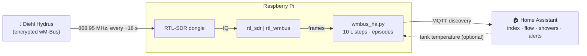

# wmbus-hydrus-ha

Track an **encrypted** wireless M-Bus water meter in Home Assistant **without the AES key**,
using a Raspberry Pi and a cheap RTL-SDR dongle.

Most utility water meters with a radio module (Diehl Hydrus, Izar, …) broadcast encrypted
telegrams. Without the key you cannot read the volume. This project counts the
**10-litre steps** instead. Whenever the meter's volume register crosses a 10 L boundary, the
encrypted payload changes in a recognisable way. From those steps you get:

- an **estimated index** (m³), anchored to a reading you take off the meter's display;
- **live consumption**: today, last 15 min / hour, flow rate, the episode in progress;
- **consumption episodes** (start, litres, duration), classified as *shower*, *short use*,
  *watering*, *possible leak*… optionally confirmed by your hot-water tank temperature;
- the data for **leak and anomaly alerts**: use at night or while away, very large episodes,
  continuous flow, no pause for hours.

Everything reaches Home Assistant through **MQTT discovery**, under one *Water meter* device.

> Developed on a Diehl Hydrus (T1 mode, 868.95 MHz). Other encrypted meters may behave
> differently. Run [`replay.py`](#check-your-meter-first) on a capture of yours first.

## How it works



`wmbus_ha.py` reads rtl_wmbus output and applies a few rules, found empirically and validated
against manual readings:

| rule | why |
|---|---|
| identical payload within 150 ms = one transmission | rtl_wmbus runs two demodulators, so most frames arrive twice |
| frames are grouped by the access number | the payload is only comparable within an access-number window |
| a change counts only after **2 consecutive** frames carry it | a single different frame is a corrupt frame that slipped past the CRC |
| a change touching **AES block 1** = one **10 L step** | volume register crossed a 10 L boundary (VIF 0x14) |
| a change only in blocks 2–3 = no step | other fields (flow, status) |
| steps less than 150 s apart = one **episode** | continuous use |

Index = your LCD reading + steps × 10 L. Steps lost to missed telegrams make the estimate fall
behind, so re-anchor it now and then from Home Assistant (*Set index*). Long-term statistics
live on **Tracked consumption**, a counter that never jumps, so recalibrating never corrupts
your history.

## Will it work with my meter?

The reception, MQTT, Home Assistant and episode parts are generic. **Step detection** relies on
four properties of the Diehl Hydrus:

1. **It repeats itself.** OMS encryption (AES-CBC, security mode 5) puts the access number into
   the IV. The Hydrus sends the **same access number for many frames in a row**, so as long as
   the volume doesn't change, the ciphertext is byte-for-byte identical. Many meters increment
   the access number on **every** transmission. Then every frame looks new and this method
   cannot work at all.
2. **Volume is in the first AES block.** Volume is the first record in the Hydrus's decrypted
   data, so "block 1 changed" means "volume changed". A meter that puts a date/time or a frame
   counter first changes block 1 constantly, and you get phantom steps.
3. **10 L resolution** (VIF `0x14`). A meter reporting whole litres would produce a "step" per
   litre. `STEP_L` in `wmbus_ha.py` is fixed at 10.
4. **Short header, CI `0x7A`.** Long-header (`0x72`) and compact/ELL frames, such as AES-CTR on
   Kamstrup, are ignored, and the block logic doesn't apply to CTR mode anyway.

Not needed for **Diehl Izar** meters: their PRIOS scrambling is weak, and
[wmbusmeters](https://github.com/wmbusmeters/wmbusmeters) decodes the real volume without a key.

**Test it** with a capture of your meter, taken while you use a known amount of water:

```bash
python3 replay.py capture.txt --id <id>
```

`replay.py` prints how many frames share an access number and warns you if it changes almost
every frame (condition 1), or if there are implausibly many steps per hour (condition 2).
Compatible means **one step per 10 L used** and **no steps while nothing runs**.

### Hot-water hint (optional)

If Home Assistant publishes your hot-water tank temperature to `wmbus/boiler/dhw_temp`, every
episode is checked when it ends. It is flagged `hot_water` if the tank **dropped ≥ 2 °C**
during it, or **started reheating** (rose ≥ 2 °C) shortly after. A standing tank loses well under
2 °C in that window, so idle cooling alone does not trigger it. The hint turns a 40 L episode into
*shower* rather than *medium use*. It is a guess, not a measurement.

## Hardware

- Raspberry Pi 3B+ or newer (the service uses about 70 % of one core on a Pi 3).
- RTL-SDR dongle. **RTL-SDR Blog V4 / V4 Lite** needs the
  [rtl-sdr-blog driver](https://github.com/rtlsdrblog/rtl-sdr-blog): the stock Debian librtlsdr
  reports *"PLL not locked"* and receives nothing. `setup/pi_setup.py` installs it.
- An MQTT broker reachable from the Pi, for example Home Assistant's Mosquitto add-on.

Placement: the Pi needs both the meter's signal and your Wi-Fi. The meter is often in a pit
with a metal lid, so test reception (`Signal` and `Last telegram` entities) before you pick a spot.

## Install

1. **Flash** Raspberry Pi OS Lite (64-bit) to a microSD card.
2. **Pre-configure** the card by replacing `user-data` (and `network-config` for Wi-Fi) on the
   `bootfs` partition with the files in [`setup/cloud-init/`](setup/cloud-init). Put in your SSH
   public key, and your SSID and password if you use Wi-Fi.
   ⚠️ Type the quotes; don't paste them from a chat app. "Smart" quotes end up inside the SSID
   and the Pi silently never joins. Cloud-init applies the network only on the **first** boot.
3. **Boot** the Pi (Ethernet is the safest first time) and find its IP.
4. **Provision** it from your computer:

   ```bash
   MQTT_PASS='…' python3 setup/pi_setup.py --host <pi-ip> --user pi --key ~/.ssh/id_ed25519 \
       --meter-id <id> --mqtt-host <broker-ip> --mqtt-user wmbus --index <m³ from the display>
   ```

   With Home Assistant OS you can let it create a random MQTT login in the Mosquitto add-on
   instead: export `HA_URL` and `HA_TOKEN`, and pass `--ha-mosquitto-addon` instead of `MQTT_PASS`.

   The script updates the system, blacklists the DVB-T driver, builds the RTL-SDR Blog driver
   and [rtl-wmbus](https://github.com/weetmuts/rtl-wmbus), installs the `wmbus-ha` systemd
   service and reboots.

The meter id is the one rtl_wmbus prints, usually the serial number on the meter (`1234 5678`
→ `12345678`). Not sure? Run `rtl_sdr -f 868.95M -s 1.6e6 -g 49.6 - | rtl_wmbus` for a minute,
next to the meter.

### Check your meter first

```bash
rtl_sdr -f 868.95M -s 1.6e6 -g 49.6 - | rtl_wmbus > capture.txt   # leave it running a while, use some water
python3 replay.py capture.txt --id <id> --episodes
```

`replay.py` runs the same rules as the service. If 10 L of water gives you one step, you are
good. Try it on the anonymised sample in [`data/`](data):

```
$ python3 replay.py data/sample_telegrams.txt --id 12345678 --anchor 80.330 --episodes
meter 12345678: 2840 frames, 15.01 15:24 -> 15.01 22:59 (7.6 h)
access numbers: 32 runs, 88.8 frames per run, 55 distinct payloads
steps: 23 = 230 L, other field changes: 0
index: 80.330 -> 80.560 m3
episodes: 10  short_use 4, shower 2, dishes_or_short_shower 2, medium_use 1, long_shower 1
…
15.01 20:57      70     10.0  long_shower
```

## Home Assistant

Entities, all under the **Water meter** device:

| entity | what |
|---|---|
| `sensor.water_meter_index` | estimated index (m³), no long-term statistics |
| `sensor.water_meter_tracked_consumption` | litres counted since install, `total_increasing`. Use this for graphs and the Energy dashboard |
| `sensor.water_meter_consumption_today` | litres today |
| `sensor.water_meter_last_15_min`, `_last_hour` | litres |
| `sensor.water_meter_flow_rate` | L/min over the last 5 min |
| `binary_sensor.water_meter_water_flowing` | an episode is in progress |
| `sensor.water_meter_current_episode`, `_current_episode_duration` | litres / minutes of the running episode |
| `sensor.water_meter_hours_without_pause` | hours since the last full hour without any step (slow-leak indicator) |
| `event.water_meter_consumption_episode` | fires per finished episode; attributes: litres, duration, type, `hot_water`, `dhw_drop` |
| `sensor.water_meter_last_episode`, `_recent_episodes` | the last one / the last 15 as attributes (for dashboards) |
| `sensor.water_meter_showers_today`, `_episodes_today` | counters |
| `sensor.water_meter_last_telegram`, `_signal` | reception diagnostics |
| `number.water_meter_set_index` | type the display reading here to re-anchor |

[`examples/home-assistant/`](examples/home-assistant) contains:

- `water_meter_package.yaml`: away mode and alert thresholds, a monthly utility meter, the
  tank-temperature bridge, and an alert automation. The automation only notifies; it never
  closes a valve.
- `dashboard_water.yaml`: a sections dashboard with today's chart (litres per 15 min, tank
  temperature, shower markers), the last 14 days, recent episodes and the alert controls.
  It needs [apexcharts-card](https://github.com/RomRider/apexcharts-card).

## Limitations

- **10 L resolution.** A 6 L toilet flush may not produce a step on its own. It merges with the
  next use. Showers, watering and leaks show clearly.
- **Missed telegrams = missed steps**, which shows up as index drift. Re-anchor occasionally.
- **Episode types are guesses** from litres, duration, time of day and the tank hint. Two people
  using water at the same time look like one episode.
- Only short-header (CI `0x7A`) frames are used, and the block-1 = volume rule was verified on
  a Diehl Hydrus only.

## Credits

- [weetmuts/rtl-wmbus](https://github.com/weetmuts/rtl-wmbus): the wM-Bus demodulator doing
  the radio work
- [rtlsdrblog/rtl-sdr-blog](https://github.com/rtlsdrblog/rtl-sdr-blog): driver for the V4 dongles

## License

MIT © [mtivadar](https://github.com/mtivadar), see [LICENSE](LICENSE). rtl-wmbus and the RTL-SDR driver are separate projects with their
own licences. They are downloaded and built on the Pi, not included here.
